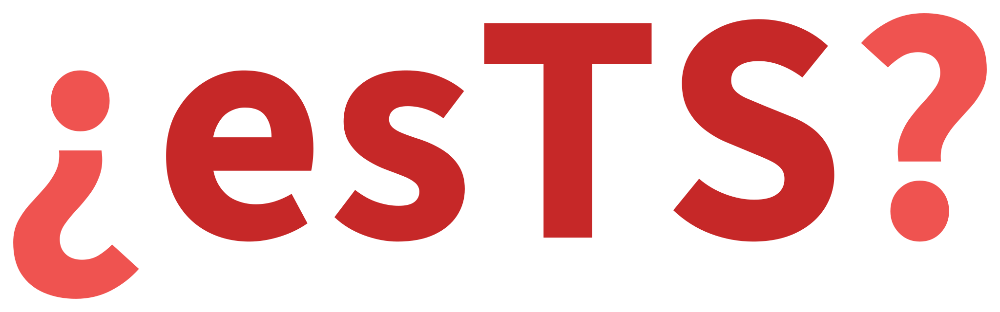

# Spanish Texts Statistics (esTS)



*¿Cómo esTáS, texto?*

**esTS** calcula estadísticas de textos en español: estadísticas básicas, legibilidad, diversidad léxica, complejidad léxica, estilo, fonoestadística, morfología, sintaxis y cohesión, con fórmulas publicadas y con los coeficientes y las escalas de sus autores, y con las categorías, los rasgos y las dependencias de Universal Dependencies.

La biblioteca trabaja tanto con cadenas como con objetos `Doc` de [spaCy](https://github.com/explosion/spaCy); la mayoría de las estadísticas no necesita un modelo entrenado ([Instalación](installation.md#model)).

Se puede probar sin instalar en la [demo en Hugging Face Spaces](https://huggingface.co/spaces/SergeyShk/esTS): pegue un texto y obtenga su legibilidad, las métricas, los gráficos y el resaltado de sus fragmentos.

## Funcionalidad

<div class="grid cards" markdown>

-   :material-scissors-cutting:{ .lg .middle } __Extracción__

    ---

    Tokenizadores de [oraciones](extractors/sentences.md), [palabras](extractors/words.md) y [N-gramas de caracteres](extractors/char_ngrams.md) que conocen los signos de apertura, la raya de diálogo y las abreviaturas del español

    [:octicons-arrow-right-24: Extracción](extractors/sentences.md)

-   :material-format-letter-case:{ .lg .middle } __Sílabas y acento__

    ---

    División de una palabra en sílabas y su acento por las reglas ortográficas, sin diccionario

    [:octicons-arrow-right-24: Sílabas y acento](syllables.md)

-   :material-counter:{ .lg .middle } __Estadísticas básicas__

    ---

    Número de oraciones, palabras, letras, sílabas y signos de puntuación por tipo y sus distribuciones

    [:octicons-arrow-right-24: Estadísticas básicas](stats/basic_stats.md)

-   :material-book-open-variant:{ .lg .middle } __Legibilidad__

    ---

    Fernández Huerta, Szigriszt-Pazos con la escala INFLESZ, Gutiérrez de Polini, Crawford, Legibilidad µ, SOL, LIX y RIX con grado de consenso, etapas escolares de España y tiempo de lectura, y fórmulas de otros idiomas con sus propios coeficientes

    [:octicons-arrow-right-24: Métricas de legibilidad](stats/readability_stats.md)

-   :material-chart-bell-curve:{ .lg .middle } __Diversidad léxica__

    ---

    Type-Token Ratio y sus variantes, MATTR, MSTTR, Measure of Textual Lexical Diversity, HD-D, los índices de Simpson y de Yule, la entropía, las leyes de Zipf y de Heaps, sobre todo el texto o por ventanas con intervalos de confianza

    [:octicons-arrow-right-24: Métricas de diversidad léxica](stats/diversity_stats.md)

-   :material-alphabetical-variant:{ .lg .middle } __Morfología__

    ---

    Categorías gramaticales y quince rasgos morfológicos de Universal Dependencies con los marcadores del español: los modos, las formas no personales, las cópulas `ser` y `estar`, los adverbios en `-mente`

    [:octicons-arrow-right-24: Estadísticas morfológicas](stats/morph_stats.md)

-   :material-file-tree:{ .lg .middle } __Sintaxis__

    ---

    Estadísticas del árbol de dependencias (distancias, profundidad, cláusulas, coordinación) con las construcciones del estilo administrativo: la pasiva con `ser` y con `se`, las cláusulas de participio y de gerundio, las cadenas de `de`, los predicados escindidos

    [:octicons-arrow-right-24: Estadísticas sintácticas](stats/syntax_stats.md)

-   :material-link-variant:{ .lg .middle } __Cohesión__

    ---

    Repetición de sustantivos, argumentos y palabras con contenido entre oraciones a la manera de Coh-Metrix, información dada, cohesión temporal y la densidad de 273 marcadores del discurso del español por clase y por lugar, entre oraciones y dentro de ellas

    [:octicons-arrow-right-24: Estadísticas de cohesión](stats/cohesion_stats.md)

-   :material-school:{ .lg .middle } __Complejidad léxica__

    ---

    Cuán raras son las palabras de un texto, a la manera de TAALES: frecuencia, rango, dispersión y sorpresa según un [diccionario de frecuencias](datasets/freqdict.md) de Google Books Ngram, las bandas de frecuencia del top-1000 al 10000, la densidad léxica

    [:octicons-arrow-right-24: Estadísticas de complejidad léxica](stats/lexical_stats.md)

-   :material-feather:{ .lg .middle } __Estilo__

    ---

    Indicadores SEO de Advego y Text.ru (náusea, contenido de agua, índice de spam, naturalidad según Zipf, densidad de palabras clave) y los marcadores del estilo burocrático según las guías de lenguaje claro en español: sustantivos deverbales, locuciones prepositivas, expresiones parentéticas y clichés

    [:octicons-arrow-right-24: Métricas de estilo](stats/style_stats.md)

-   :material-waveform:{ .lg .middle } __Fonética__

    ---

    Proporciones de las clases de sonidos de una transcripción por reglas, grupos consonánticos, hiatos, sílabas abiertas, dureza e índices de aliteración y de asonancia

    [:octicons-arrow-right-24: Fonoestadística](stats/phon_stats.md)

-   :material-music-note:{ .lg .middle } __Verso__

    ---

    Las sílabas métricas y el metro de un poema, el perfil acentual y los tipos del endecasílabo, la rima consonante y asonante con su esquema, las estrofas y la forma de un poema

    [:octicons-arrow-right-24: Estadísticas del verso](stats/verse_stats.md)

-   :material-bookshelf:{ .lg .middle } __Medidas de corpus__

    ---

    [Palabras clave](corpus/keyness.md) frente a un corpus de referencia o al diccionario de frecuencias, [colocaciones](corpus/collocations.md), la [dispersión](corpus/dispersion.md) de una palabra por las partes de un texto, una [concordancia KWIC](corpus/kwic.md), la autoría por [estilometría](corpus/stylometry.md) (la Delta de Burrows, Zeta, la curva de Mendenhall, las palabras funcionales) y la [comparación de corpus](corpus/compare.md) por 133 rasgos de un texto

    [:octicons-arrow-right-24: Medidas de corpus](corpus/keyness.md)

-   :material-database:{ .lg .middle } __Conjuntos de datos__

    ---

    Un [corpus de literatura en español](datasets/spanishliterature.md) de dominio público (150 obras de 33 autores en cuatro géneros), una [colección de sonetos](datasets/spanishsonnets.md) de los siglos XV-XX con el patrón métrico y la rima de cada verso y un [diccionario de frecuencias](datasets/freqdict.md) de 83 785 lemas según Google Books Ngram

    [:octicons-arrow-right-24: Conjuntos de datos](datasets/spanishliterature.md)

-   :material-chart-scatter-plot:{ .lg .middle } __Visualización__

    ---

    [Ley de Zipf](visualizers/zipf.md), [huella literaria](visualizers/fingerprinting.md), [árbol de palabras](visualizers/word_tree.md), gráficos [de corpus](visualizers/corpus.md) y [estilométricos](visualizers/stylometry.md), [crecimiento del vocabulario y espectro de frecuencias](visualizers/vocabulary.md), [longitudes de las oraciones](visualizers/sentences.md) y el [resaltado del texto](visualizers/highlight.md) por los fragmentos que cuentan las estadísticas

    [:octicons-arrow-right-24: Visualizaciones](visualizers/zipf.md)

-   :material-pipe:{ .lg .middle } __Componentes__

    ---

    Componentes de un pipeline de spaCy, de modo que el texto se anote y se mida en una sola pasada y las estadísticas viajen con el `Doc`

    [:octicons-arrow-right-24: Componentes de spaCy](components.md)

-   :material-alert-circle-outline:{ .lg .middle } __Excepciones__

    ---

    Errores de una sola jerarquía cuyas clases son también excepciones integradas de Python

    [:octicons-arrow-right-24: Excepciones y registro](exceptions.md)

</div>

## Instalación

Se requiere Python 3.11 o superior.

``` bash
pip install pyests
```

La distribución en PyPI se llama `pyests` y el paquete que instala es `ests`. Las dependencias, el modelo de spaCy y los conjuntos de datos están en la página de [Instalación](installation.md).

## Primeros pasos

=== "Código"

    ``` python
    from ests import BasicStats, DiversityStats, ReadabilityStats

    text = "Hay tres clases de mentiras: mentiras, malditas mentiras y estadísticas"

    BasicStats(text).get_stats()
    ReadabilityStats(text).flesch_reading_easy
    DiversityStats(text).ttr
    ```

=== "Resultado"

    ```
    {'c_letters': {1: 1, 2: 1, 3: 1, 4: 1, 6: 1, 8: 4, 12: 1},
     'c_syllables': {1: 4, 2: 1, 3: 4, 5: 1},
     'n_sents': 1,
     'n_words': 10,
     'n_unique_words': 8,
     'n_long_words': 5,
     'n_complex_words': 5,
     'n_simple_words': 5,
     'n_monosyllable_words': 4,
     'n_polysyllable_words': 6,
     'n_chars': 71,
     'n_letters': 60,
     'n_spaces': 9,
     'n_syllables': 23,
     'n_punctuations': 2,
     'letters_entropy': 2.5219280948873624,
     'syllables_entropy': 1.7219280948873623,
     'c_punctuations': {'comma': 1,
                        'period': 0,
                        'question': 0,
                        'exclamation': 0,
                        'ellipsis': 0,
                        'colon': 1,
                        'semicolon': 0,
                        'dash': 0,
                        'hyphen': 0,
                        'angle_quotes': 0,
                        'straight_quotes': 0,
                        'parentheses': 0,
                        'other': 0}}
    53.545000000000016
    0.8
    ```

Cualquier estadística puede mostrarse en forma legible:

=== "Código"

    ``` python
    BasicStats(text).print_stats()
    ```

=== "Resultado"

    ```
                       Statistic                    |  Value
    -----------------------------------------------------------
    Sentences                                       |    1
    Words                                           |    10
    Unique words                                    |    8
    Long words                                      |    5
    Complex words                                   |    5
    Simple words                                    |    5
    Monosyllabic words                              |    4
    Polysyllabic words                              |    6
    Characters                                      |    71
    Letters                                         |    60
    Spaces                                          |    9
    Syllables                                       |    23
    Punctuation marks                               |    2
    Entropy of the word lengths in letters (bits)   |   2.52
    Entropy of the word lengths in syllables (bits) |   1.72
    ```

Un cuento analizado con todas las herramientas de la biblioteca está en el cuaderno [examples/01_text_walkthrough.ipynb](https://github.com/SergeyShk/esTS/blob/master/examples/01_text_walkthrough.ipynb), que se abre en [Colab](https://colab.research.google.com/github/SergeyShk/esTS/blob/master/examples/01_text_walkthrough.ipynb); los cuadernos sobre los prosistas, los sonetos y las medidas de corpus están en la página de [ejemplos](examples.md).

??? note "Estructura del proyecto"

    *   **demo** - la demo en Hugging Face Spaces (Gradio)
    *   **docs** - documentación del proyecto
    *   **ests**:
        *   basic_stats.py - estadísticas básicas del texto
        *   cohesion_stats.py - estadísticas de cohesión
        *   components.py - componentes de spaCy
        *   constants.py - constantes de la lengua española y de las métricas
        *   diversity_stats.py - métricas de diversidad léxica
        *   exceptions.py - excepciones de la biblioteca
        *   extractors.py - extractores de oraciones, palabras y N-gramas de caracteres con los tokenizadores del español
        *   lexical_stats.py - estadísticas de complejidad léxica
        *   morph_stats.py - estadísticas morfológicas
        *   phon_stats.py - fonoestadística
        *   readability_stats.py - métricas de legibilidad
        *   unadapted_readability_stats.py - fórmulas de legibilidad de otros idiomas
        *   style_stats.py - métricas de estilo
        *   syllables.py - silabificación y acento
        *   syntax_stats.py - estadísticas sintácticas
        *   utils.py - herramientas auxiliares
        *   verse_stats.py - estadísticas del verso
        *   **corpus** - medidas de corpus:
            *   collocations.py - colocaciones y medidas de asociación
            *   compare.py - comparación de corpus por los rasgos de un texto
            *   dispersion.py - dispersión de una palabra por las partes de un texto
            *   keyness.py - palabras clave frente a un corpus de referencia o al diccionario de frecuencias
            *   kwic.py - concordancia KWIC
            *   stylometry.py - la Delta de Burrows, Zeta, las palabras funcionales y otras medidas de estilometría
        *   **datasets** - conjuntos de datos:
            *   freq_dict.py - el diccionario de frecuencias según Google Books Ngram
            *   spanish_literature.py - el corpus de literatura en español
            *   spanish_sonnets.py - los sonetos de los siglos XV-XX
        *   **resources** - recursos léxicos incluidos (los marcadores del discurso, los 10 000 lemas más frecuentes)
        *   **visualizers** - gráficos:
            *   corpus.py - dispersión léxica, gráfico de palabras clave, red de colocaciones
            *   fingerprinting.py - huella literaria
            *   highlight.py - resaltado del texto
            *   sentences.py - longitudes de las oraciones
            *   stylometry.py - dendrograma, componentes principales, escalamiento, curvas de Mendenhall
            *   vocabulary.py - crecimiento del vocabulario y espectro de frecuencias
            *   word_tree.py - árbol de palabras
            *   zipf.py - ley de Zipf
    *   **examples** - cuadernos con ejemplos
    *   **scripts** - scripts que construyen los archivos de los conjuntos de datos, traen las páginas de anyTS de la documentación y comprueban las salidas de los cuadernos
    *   **tests** - pruebas que reproducen la estructura del paquete
