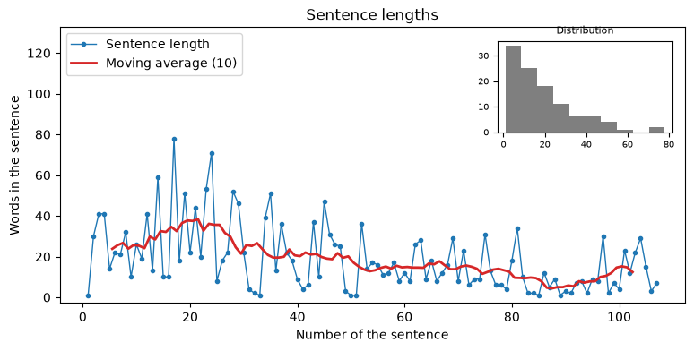

# Sentence lengths

``` {.python .signature}
sentence_lengths_plot(source, window=10, inset=True, ax=None, labels=None, sents_extractor=None, words_extractor=None)
```

--8<-- "visualizers/sentences.md:sentence_lengths_plot"

The functions are those of the [anyTS](https://sergeyshk.github.io/anyTS/visualizers/sentences/) core; for a string esTS passes its Spanish [`SentsExtractor`](../extractors/sentences.md) and [`WordsExtractor`](../extractors/words.md) by default, and the `sents_extractor` and `words_extractor` parameters replace them. The default labels are the English ones of `VISUALIZER_LABELS` in `anyts.constants`; `labels` replaces any of them.

The curve of the second window of 2000 words of *Niebla* by Unamuno from the [corpus of literature](../datasets/spanishliterature.md); a window is cut by words, so it opens with the end of a sentence:

``` python
from ests.corpus import split_windows
from ests.datasets import SpanishLiterature
from ests.visualizers import sentence_lengths_plot

sl = SpanishLiterature()
sl.download()
text = next(
    record["text"] for record in sl.get_records(author="unamuno") if record["title"] == "Niebla"
)
chapter = split_windows(text, 2000)[1]
sentence_lengths_plot(chapter, window=10)
```

{: .center }

## Parameters

--8<-- "visualizers/sentences.md:sentence_lengths_plot-parameters"

## Lengths of the sentences { #sentence_lengths }

``` {.python .signature}
sentence_lengths(source, sents_extractor=None, words_extractor=None)
```

The lengths of the sentences in words, in order: a string is split into sentences by the sentence extractor and every sentence into words by the word extractor; the sentences of a `Doc` come from its boundaries and its words from its tokens, punctuation and symbols left out, while a `Doc` without boundaries or with partial ones (`has_sents`) is counted as its text, by the extractors. Sentences without words are skipped. Ready lengths (non-negative integers in a sequence or an iterator) are used as they are. The arguments are those of `sentence_lengths_plot`.

Raises:

- `SourceTypeError` - an object that is not a string, a `Doc`, a sequence or an iterator, a table, a set, a mapping, bytes, a length that is not an integer, an extractor of another type;
- `SourceError` - a negative length, a string with a character without a UTF-8 form.

=== "Code"

    ``` python
    from ests.visualizers import sentence_lengths

    sentence_lengths("El gato duerme. ¿Y el perro? —Come —dijo ella.")
    sentence_lengths(chapter)[:5]
    ```

=== "Result"

    ```
    [3, 3, 3]
    [1, 30, 41, 41, 14]
    ```
