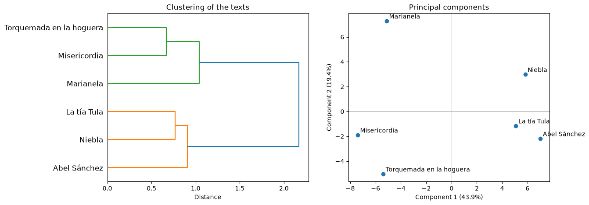
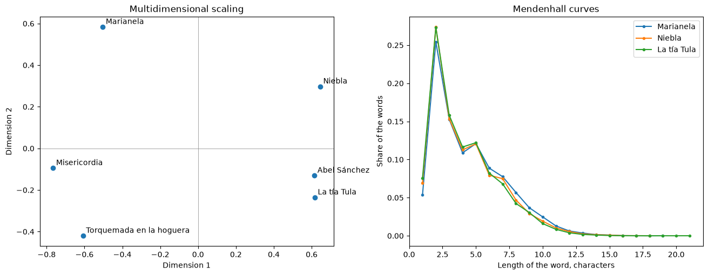
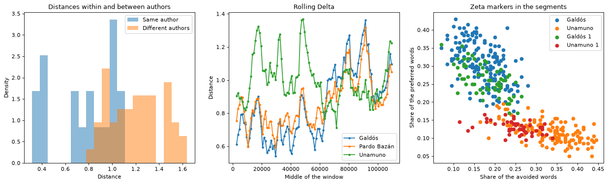

# Gráficos estilométricos

Gráficos para la [estilometría](../corpus/stylometry.md): un dendrograma, el escalamiento multidimensional y los histogramas de las distancias dentro de un autor y entre autores de la matriz de distancias de [`delta`](../corpus/stylometry.md#delta), las componentes principales de las frecuencias de las palabras más frecuentes, las distancias de la Delta móvil a lo largo de un texto, los segmentos de los corpus por los marcadores de Zeta y las curvas de Mendenhall de varios textos. Las funciones reciben los ejes `ax` y devuelven `Axes`.

Las funciones son las del núcleo [anyTS](https://sergeyshk.github.io/anyTS/visualizers/stylometry/); las frecuencias de las componentes principales salen de [`frequency_table`](../corpus/stylometry.md#delta), las distancias a lo largo de un texto de [`rolling_delta`](../corpus/stylometry.md#rolling_delta), los segmentos de [`zeta_segments`](../corpus/stylometry.md#zeta) y las curvas de [`mendenhall_curve`](../corpus/stylometry.md#mendenhall). Las etiquetas por defecto son las inglesas de `VISUALIZER_LABELS` en `anyts.constants`; `labels` sustituye cualquiera de ellas.

## Dendrograma { #dendrogram_plot }

<!-- core: visualizers/stylometry.md:dendrogram_plot e3f6319 -->
``` {.python .signature}
dendrogram_plot(distances, method='ward', ax=None, labels=None)
```

Agrupamiento jerárquico con `scipy.cluster.hierarchy` sobre la matriz de distancias entre textos, por defecto con el método de Ward, como en [Evert et al. (2015)](https://aclanthology.org/W15-0709.pdf); las hojas se etiquetan con el índice de la matriz. Las columnas se toman en el orden de las filas.

| Parámetro | Tipo | Por defecto | Descripción |
| :-------- | :--- | :------ | :---------- |
| `distances` | `DataFrame` | - | Matriz simétrica de distancias con los nombres de los textos en las filas y en las columnas, en cualquier orden |
| `method` | `str` | `'ward'` | Método de `scipy.cluster.hierarchy.linkage` para unir los grupos: `single`, `complete`, `average`, `weighted`, `centroid`, `median` o `ward` |
| `ax` | `Axes` | `None` | Ejes para el gráfico |
| `labels` | `dict[str, str]` | `None` | Etiquetas sobre las de por defecto: `title`, `xlabel` |

Textos distintos en las columnas y en las filas, menos de dos textos, una distancia infinita o negativa, la asimetría o una distancia en la diagonal lanzan `SourceError` antes de crear una figura. Unas distancias que no son un `DataFrame` de números lanzan `SourceTypeError`; un `method` desconocido, unas etiquetas que `merge_labels` rechaza y un `ax` que no es un `Axes` de matplotlib lanzan `ParameterError`.

## Componentes principales { #pca_plot }

<!-- core: visualizers/stylometry.md:pca_plot b21b905 -->
``` {.python .signature}
pca_plot(corpus, n_mfw=100, culling=0.0, ax=None, labels=None)
```

Análisis de componentes principales de las puntuaciones z de las frecuencias relativas de las unidades más frecuentes (`frequency_table`, `z_scores`): los textos en el plano de las dos primeras componentes con sus nombres, y la proporción de la varianza explicada en las etiquetas de los ejes.

| Parámetro | Tipo | Por defecto | Descripción |
| :-------- | :--- | :------ | :---------- |
| `corpus` | `dict[str, list[str]]` | - | Unidades de los textos por los nombres de los textos |
| `n_mfw` | `int` | `100` | Número de las unidades más frecuentes; `None` - todas |
| `culling` | `float` | `0.0` | Menor proporción de textos en la que aparece una unidad |
| `ax` | `Axes` | `None` | Ejes para el gráfico |
| `labels` | `dict[str, str]` | `None` | Etiquetas sobre las de por defecto: `title`, `xlabel` y `ylabel` (cadenas de formato con la proporción explicada `share`) |

El corpus, `n_mfw` y `culling` lanzan los errores de `frequency_table`, y menos de tres textos lanzan `SourceError`; unas etiquetas que `merge_labels` rechaza y un `ax` que no es un `Axes` de matplotlib lanzan `ParameterError`.

## Escalamiento multidimensional { #mds_plot }

<!-- core: visualizers/stylometry.md:mds_plot fee8015 -->
``` {.python .signature}
mds_plot(distances, ax=None, labels=None)
```

Escalamiento multidimensional clásico (Torgerson 1952) de cualquier matriz de distancias: los dos vectores propios principales de las distancias al cuadrado con doble centrado, así que las distancias entre los puntos aproximan las de la matriz. Las columnas se toman en el orden de las filas.

| Parámetro | Tipo | Por defecto | Descripción |
| :-------- | :--- | :------ | :---------- |
| `distances` | `DataFrame` | - | Matriz simétrica de distancias con los nombres de los textos en las filas y en las columnas, en cualquier orden |
| `ax` | `Axes` | `None` | Ejes para el gráfico |
| `labels` | `dict[str, str]` | `None` | Etiquetas sobre las de por defecto: `title`, `xlabel`, `ylabel` |

Textos distintos en las columnas y en las filas, menos de dos textos, una distancia infinita o negativa, la asimetría o una distancia en la diagonal lanzan `SourceError` antes de crear una figura. Unas distancias que no son un `DataFrame` de números lanzan `SourceTypeError`; unas etiquetas que `merge_labels` rechaza y un `ax` que no es un `Axes` de matplotlib lanzan `ParameterError`.

## Distancias dentro de un autor y entre autores { #delta_histogram_plot }

<!-- core: visualizers/stylometry.md:delta_histogram_plot 9012f2b -->
``` {.python .signature}
delta_histogram_plot(distances, authors, bins=20, ax=None, labels=None)
```

Los histogramas de las distancias de los pares de textos de un mismo autor y de los pares de autores distintos, como densidades sobre unos intervalos comunes, así que los grupos de tamaños distintos son comparables. Cuanto menos se solapan los histogramas, mejor distinguen las distancias a los autores: una comprobación del número de unidades y de la variante de Delta en textos de autores conocidos. Las columnas se toman en el orden de las filas.

| Parámetro | Tipo | Por defecto | Descripción |
| :-------- | :--- | :------ | :---------- |
| `distances` | `DataFrame` | - | Matriz simétrica de distancias con los nombres de los textos en las filas y en las columnas, en cualquier orden |
| `authors` | `dict[str, str]` | - | Autores de los textos por los nombres de los textos |
| `bins` | `int` | `20` | Número de intervalos, como máximo 1000 |
| `ax` | `Axes` | `None` | Ejes para el gráfico |
| `labels` | `dict[str, str]` | `None` | Etiquetas sobre las de por defecto: `title`, `xlabel`, `ylabel` y las de la leyenda `within`, `between` |

La matriz lanza los errores de `dendrogram_plot`; unos autores que no son un mapeo lanzan `SourceTypeError`, y un texto sin autor, ningún par de textos de un mismo autor o todos los textos de un mismo autor, `SourceError`. Un `bins` que no es un entero de 1 a 1000, unas etiquetas que `merge_labels` rechaza y un `ax` que no es un `Axes` de matplotlib lanzan `ParameterError`.

## Delta móvil { #rolling_delta_plot }

<!-- core: visualizers/stylometry.md:rolling_delta_plot 750ad6a -->
``` {.python .signature}
rolling_delta_plot(distances, ax=None, labels=None)
```

Las distancias de `rolling_delta` como una línea por cada texto de referencia sobre los centros de las ventanas: la línea más baja es la referencia más cercana de una parte del texto, y donde las líneas se cruzan, cambia el estilo.

| Parámetro | Tipo | Por defecto | Descripción |
| :-------- | :--- | :------ | :---------- |
| `distances` | `DataFrame` | - | Distancias de `rolling_delta`: las ventanas por la posición de su centro en las filas, los textos de referencia en las columnas |
| `ax` | `Axes` | `None` | Ejes para el gráfico |
| `labels` | `dict[str, str]` | `None` | Etiquetas sobre las de por defecto: `title`, `xlabel`, `ylabel` |

Unas distancias que no son un `DataFrame` de números con números en el índice lanzan `SourceTypeError`; la falta de ventanas o de textos de referencia, una posición no finita y una distancia infinita o negativa lanzan `SourceError` antes de crear una figura. Unas etiquetas que `merge_labels` rechaza y un `ax` que no es un `Axes` de matplotlib lanzan `ParameterError`.

## Diagrama de dispersión de Zeta { #zeta_scatter_plot }

<!-- core: visualizers/stylometry.md:zeta_scatter_plot 3bb8600 -->
``` {.python .signature}
zeta_scatter_plot(segments, ax=None, labels=None)
```

Los segmentos de `zeta_segments` en el plano de las proporciones de las palabras evitadas (eje horizontal) y de las preferidas (eje vertical), con un color por corpus, como en `oppose` de stylo.

| Parámetro | Tipo | Por defecto | Descripción |
| :-------- | :--- | :------ | :---------- |
| `segments` | `DataFrame` | - | Segmentos de `zeta_segments` con las columnas `corpus`, `preferred` y `avoided` |
| `ax` | `Axes` | `None` | Ejes para el gráfico |
| `labels` | `dict[str, str]` | `None` | Etiquetas sobre las de por defecto: `title`, `xlabel`, `ylabel` |

Unos segmentos que no son un `DataFrame` o unas proporciones que no son números lanzan `SourceTypeError`; una columna ausente o repetida, la falta de segmentos y una proporción no finita lanzan `SourceError` antes de crear una figura. Los segmentos sin nombre de corpus (`NaN`) se dibujan como un corpus propio. Unas etiquetas que `merge_labels` rechaza y un `ax` que no es un `Axes` de matplotlib lanzan `ParameterError`.

## Curvas de Mendenhall { #mendenhall_plot }

<!-- core: visualizers/stylometry.md:mendenhall_plot 921690d -->
``` {.python .signature}
mendenhall_plot(corpus, ax=None, labels=None)
```

Las proporciones de las palabras por longitud en caracteres (`mendenhall_curve`) de cada texto en un mismo gráfico; una longitud que ninguna palabra tiene se dibuja en cero.

| Parámetro | Tipo | Por defecto | Descripción |
| :-------- | :--- | :------ | :---------- |
| `corpus` | `dict[str, list[str]]` | - | Palabras de los textos por los nombres de los textos |
| `ax` | `Axes` | `None` | Ejes para el gráfico |
| `labels` | `dict[str, str]` | `None` | Etiquetas sobre las de por defecto: `title`, `xlabel`, `ylabel` |

Un corpus que no es un mapeo de listas de cadenas lanza `SourceTypeError`, la falta de textos o un texto sin palabras `SourceError`; unas etiquetas que `merge_labels` rechaza y un `ax` que no es un `Axes` de matplotlib lanzan `ParameterError`.

Los gráficos de seis novelas del [corpus de literatura](../datasets/spanishliterature.md), tres de Galdós y tres de Unamuno:

``` python
import matplotlib.pyplot as plt

from ests import WordsExtractor
from ests.corpus import delta
from ests.datasets import SpanishLiterature
from ests.visualizers import dendrogram_plot, mds_plot, mendenhall_plot, pca_plot

sl = SpanishLiterature()
sl.download()
titles = (
    "Marianela",
    "Misericordia",
    "Torquemada en la hoguera",
    "Niebla",
    "Abel Sánchez",
    "La tía Tula",
)
novels = {
    record["title"]: record["text"]
    for author in ("galdos", "unamuno")
    for record in sl.get_records(author=author)
    if record["title"] in titles
}
we = WordsExtractor(lowercase=True)
corpus = {title: we.extract(novels[title]) for title in titles}
distances = delta(corpus, n_mfw=100, variant="cosine")

# Dendrograma y componentes principales en una figura
fig, (left, right) = plt.subplots(1, 2, figsize=(13, 5))
dendrogram_plot(distances, ax=left)
pca_plot(corpus, n_mfw=100, ax=right)

# Escalamiento multidimensional y curvas de Mendenhall
fig, (left, right) = plt.subplots(1, 2, figsize=(13, 5), layout="constrained")
mds_plot(distances, ax=left)
mendenhall_plot(
    {title: corpus[title] for title in ("Marianela", "Niebla", "La tía Tula")}, ax=right
)
```

{: .center }

{: .center }

La Delta coseno sobre las 100 palabras más frecuentes separa a los autores: el dendrograma une las novelas de cada autor antes de unir los dos grupos, y la primera componente principal pone a Galdós a un lado y a Unamuno al otro. Las curvas de Mendenhall apenas difieren: la longitud de las palabras es un rasgo débil por sí sola.

Los gráficos de doce novelas y relatos del género `prose` del [corpus de literatura](../datasets/spanishliterature.md), cuatro de Galdós, cuatro de Pardo Bazán y cuatro de Unamuno: las distancias entre todas las obras, la Delta móvil sobre la primera obra de Galdós seguida de la primera obra de Unamuno con las otras tres obras de cada autor como referencias, y los segmentos por los marcadores de Zeta de Galdós frente a Unamuno:

``` python
from ests.corpus import rolling_delta, zeta, zeta_segments
from ests.visualizers import delta_histogram_plot, rolling_delta_plot, zeta_scatter_plot

names = {"galdos": "Galdós", "pardo": "Pardo Bazán", "unamuno": "Unamuno"}
corpus, authors = {}, {}
for key, author in names.items():
    texts = sl.get_texts(genre="prose", author=key, min_len=40000, max_len=400000, limit=4)
    for i, text in enumerate(texts, 1):
        corpus[f"{author} {i}"] = we.extract(text)
        authors[f"{author} {i}"] = author
known = {author: [corpus[f"{author} {i}"] for i in (2, 3, 4)] for author in names.values()}
reference = {author: [word for words in known[author] for word in words] for author in known}
scores = zeta(known["Galdós"], known["Unamuno"], segment_size=1000)
preferred = [score.word for score in scores[:200]]
avoided = [score.word for score in scores[-200:]]
corpora = {
    "Galdós": known["Galdós"],
    "Unamuno": known["Unamuno"],
    "Galdós 1": corpus["Galdós 1"],
    "Unamuno 1": corpus["Unamuno 1"],
}

fig, axes = plt.subplots(1, 3, figsize=(19, 5))
delta_histogram_plot(delta(corpus, n_mfw=100, variant="cosine"), authors, ax=axes[0])
rolling_delta_plot(
    rolling_delta(reference, corpus["Galdós 1"] + corpus["Unamuno 1"], window=5000, step=1000),
    ax=axes[1],
)
zeta_scatter_plot(zeta_segments(corpora, preferred, avoided, segment_size=1000), ax=axes[2])
```

{: .center }

Las distancias entre las obras de un mismo autor quedan en su mayoría por debajo de las distancias entre obras de autores distintos. A lo largo de la novela de Galdós su autor más cercano es Galdós en 57 ventanas de 61; a lo largo de la de Unamuno, Unamuno en 26 de 42 y Pardo Bazán en las demás: una ventana de 5000 palabras es corta para Delta. En el plano de los marcadores de Zeta, los segmentos de las dos obras que quedaron fuera de su cálculo caen en las nubes de sus autores.
