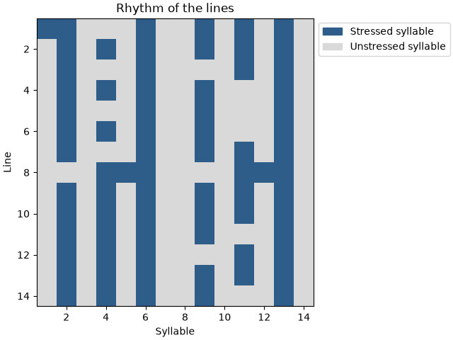

# Ritmo de los versos

<!-- core: visualizers/verse.md:rhythm_plot 0905b0d -->
``` {.python .signature}
rhythm_plot(patterns, stressed, ax=None, labels=None)
```

Una fila por verso y una celda por sílaba de su patrón, numeradas desde 1: las sílabas acentuadas en un color, las demás en otro, nada más allá del final de un verso, de modo que las columnas de un metro y los versos que lo rompen se ven de un vistazo.

| Parámetro | Tipo | Por defecto | Descripción |
| :-------- | :--- | :------ | :---------- |
| `patterns` | `list[str]` | - | Patrones de los versos, un carácter por sílaba |
| `stressed` | `str` | - | Carácter de una sílaba acentuada en los patrones |
| `ax` | `Axes` | `None` | Ejes para el gráfico |
| `labels` | `dict[str, str]` | `None` | Etiquetas sobre las de por defecto: `title`, `xlabel`, `ylabel`, `stressed`, `unstressed` (la leyenda) |

Unos patrones que no son una lista de cadenas lanzan `SourceTypeError`, la falta de versos `SourceError`; un `stressed` que no es un solo carácter, unas etiquetas que `merge_labels` rechaza y un `ax` que no es un `Axes` de matplotlib lanzan `ParameterError`.

Es la función del núcleo [anyTS](https://sergeyshk.github.io/anyTS/visualizers/verse/). Las etiquetas por defecto son las inglesas de `VISUALIZER_LABELS` en `anyts.constants`; `labels` sustituye cualquiera de ellas. Los patrones de los versos son los `patterns` de [`VerseStats`](../stats/verse_stats.md), y el carácter de una sílaba acentuada es `PATTERN_STRESSED` de `ests.verse_stats`.

*Caupolicán* de Rubén Darío de los [sonetos](../datasets/spanishsonnets.md), en alejandrinos: cada verso acentúa la sexta y la decimotercera sílabas, los finales de sus dos hemistiquios.

``` python
from ests import VerseStats
from ests.datasets import SpanishSonnets
from ests.verse_stats import PATTERN_STRESSED
from ests.visualizers import rhythm_plot

ss = SpanishSonnets()
ss.download()
sonnet = next(
    record["text"] for record in ss.get_records(author="darío") if record["title"] == "CAUPOLICÁN"
)
vs = VerseStats(sonnet)
rhythm_plot(vs.patterns, PATTERN_STRESSED)
```

{: .center }
