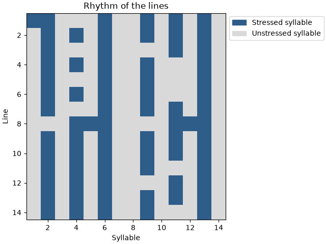

# Rhythm of the lines

--8<-- "visualizers/verse.md:rhythm_plot"

It is the function of the [anyTS](https://sergeyshk.github.io/anyTS/visualizers/verse/) core. The default labels are the English ones of `VISUALIZER_LABELS` in `anyts.constants`; `labels` replaces any of them. The patterns of the lines are the `patterns` of [`VerseStats`](../stats/verse_stats.md), and the character of a stressed syllable is `PATTERN_STRESSED` of `ests.verse_stats`.

*Caupolicán* by Rubén Darío from the [sonnets](../datasets/spanishsonnets.md), in alexandrines: every line stresses the sixth and the thirteenth syllables, the ends of its two hemistichs.

``` python
from ests import VerseStats
from ests.datasets import SpanishSonnets
from ests.verse_stats import PATTERN_STRESSED
from ests.visualizers import rhythm_plot

ss = SpanishSonnets()
ss.download()
sonnet = next(
    record["text"] for record in ss.get_records(author="darío") if record["title"] == "CAUPOLICÁN"
)
vs = VerseStats(sonnet)
rhythm_plot(vs.patterns, PATTERN_STRESSED)
```

{: .center }
