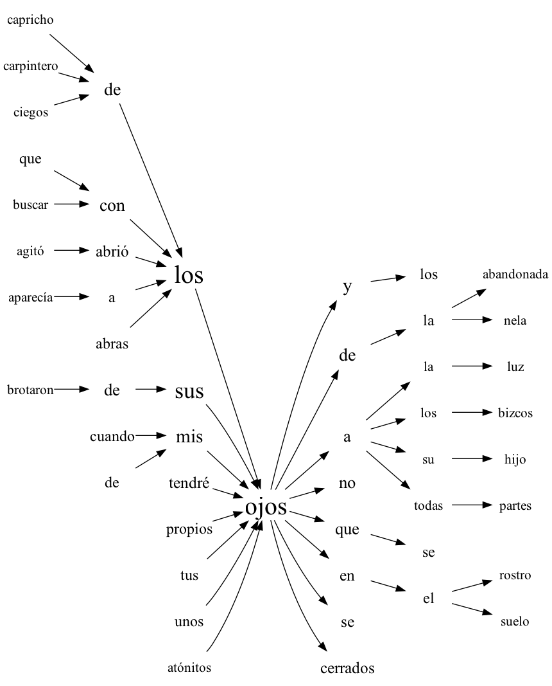

# Word tree

--8<-- "visualizers/word_tree.md:wordtree"

The function is that of the [anyTS](https://sergeyshk.github.io/anyTS/visualizers/word_tree/) core.

The tree of the sentences of *Marianela* by Galdós from the [corpus of literature](../datasets/spanishliterature.md):

``` python
from ests import SentsExtractor, WordsExtractor
from ests.datasets import SpanishLiterature
from ests.visualizers import wordtree

sl = SpanishLiterature()
sl.download()
text = next(
    record["text"] for record in sl.get_records(author="galdos") if record["title"] == "Marianela"
)

we = WordsExtractor(lowercase=True)
sentences = [we.extract(sentence) for sentence in SentsExtractor().extract(text)]
graph = wordtree(sentences, "ojos", max_n=4)
graph.render("wordtree", format="png")
```

{: .center }

## Parameters

--8<-- "visualizers/word_tree.md:wordtree-parameters"
