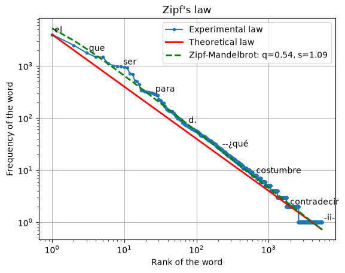

# Ley de Zipf

<!-- core: visualizers/zipf.md:zipf a98a76b -->
``` {.python .signature}
zipf(counter, num_words=None, num_labels=10, log=True, show_theory=False, alpha=1.5, show_fit=False, ax=None, labels=None)
```

El gráfico de la [ley de Zipf](https://es.wikipedia.org/wiki/Ley_de_Zipf) a partir de un contador de frecuencias de palabras.

!!! quote "Definición"

    La ley de Zipf (la ley de rango y frecuencia) es una regularidad empírica de las frecuencias de las palabras en una lengua natural: con las palabras de una lengua, o de un texto lo bastante largo, ordenadas por frecuencia descendente, la frecuencia de la n-ésima palabra es aproximadamente inversamente proporcional a su rango n. La segunda palabra más frecuente aparece más o menos la mitad de veces que la primera, la tercera un tercio, y así sucesivamente.

Las funciones son las del núcleo [anyTS](https://sergeyshk.github.io/anyTS/visualizers/zipf/). Las etiquetas por defecto son las inglesas de `VISUALIZER_LABELS` en `anyts.constants`; `labels` sustituye cualquiera de ellas, por ejemplo `labels={"title": "Ley de Zipf"}`.

Los lemas de *Marianela* de Galdós del [corpus de literatura](../datasets/spanishliterature.md):

``` python
from collections import Counter

from ests import WordsExtractor
from ests.datasets import SpanishLiterature
from ests.visualizers import zipf

sl = SpanishLiterature()
sl.download()
text = next(
    record["text"] for record in sl.get_records(author="galdos") if record["title"] == "Marianela"
)
counts = Counter(WordsExtractor(use_lexemes=True, lowercase=True, filter_nums=True).extract(text))

ax = zipf(counts, num_labels=10, show_theory=True, alpha=1.0, show_fit=True)
ax.figure.savefig("zipf.png")
```

{: .center }

En ejes logarítmicos las frecuencias de los lemas caen a lo largo de una recta; el ajuste de Zipf-Mandelbrot las sigue más de cerca en la cabeza de la lista que la ley teórica con $\alpha = 1$.

## Parámetros

<!-- core: visualizers/zipf.md:zipf-parameters c030ff5 -->
| Parámetro | Tipo | Por defecto | Descripción |
| :-------- | :--- | :------ | :---------- |
| `counter` | `Counter` | - | Contador de frecuencias de palabras |
| `num_words` | `int` | `None` | Número de las palabras más frecuentes |
| `num_labels` | `int` | `10` | Número de palabras etiquetadas en el gráfico |
| `log` | `bool` | `True` | Usar una escala logarítmica |
| `show_theory` | `bool` | `False` | Dibujar la ley de Zipf teórica |
| `alpha` | `float` | `1.5` | Exponente α de la ley de Zipf teórica, mayor que cero |
| `show_fit` | `bool` | `False` | Dibujar el ajuste de Zipf-Mandelbrot $f(r) = C / (r + q)^s$ de `fit_zipf_mandelbrot` |
| `ax` | `Axes` | `None` | Ejes de matplotlib para el gráfico; si no se dan, se crea una figura nueva |
| `labels` | `dict[str, str]` | `None` | Etiquetas del gráfico sobre las de por defecto: `title`, `xlabel`, `ylabel`, `experimental` y `theoretical` (las curvas), `fit` (una cadena de formato con `q` y `s`) |

La función devuelve los `Axes` con el gráfico; un `num_words` mayor que el número de tipos de palabra no alarga las curvas más allá de los datos. Un contador que no es un `Counter` de cadenas lanza `SourceTypeError`, y un contador vacío o una frecuencia que no es mayor que cero `SourceError`. Un `num_words` menor que uno, un `num_labels` negativo, con `show_theory` un exponente que no es un número finito mayor que cero, unas etiquetas que `merge_labels` rechaza y un `ax` que no es un `Axes` de matplotlib lanzan `ParameterError`. Todos ellos se lanzan antes de crear una figura.

El ajuste de Zipf-Mandelbrot se describe en [`fit_zipf_mandelbrot`](../stats/diversity_stats.md#fit_zipf_mandelbrot).

## Ley teórica { #zipf_theory }

<!-- core: visualizers/zipf.md:zipf_theory 20746c7 -->
``` {.python .signature}
zipf_theory(size, num_ranks, alpha=1.5, ax=None, labels=None)
```

La curva teórica sola, $f(r) = size \cdot r^{-\alpha}$ para los rangos de 1 a `num_ranks`.

| Parámetro | Tipo | Por defecto | Descripción |
| :-------- | :--- | :------ | :---------- |
| `size` | `int` / `float` | - | Frecuencia del primer rango |
| `num_ranks` | `int` | - | Número de rangos |
| `alpha` | `float` | `1.5` | Exponente α |
| `ax` | `Axes` | `None` | Ejes de matplotlib para el gráfico; si no se dan, se crea una figura nueva |
| `labels` | `dict[str, str]` | `None` | Etiquetas sobre las de por defecto: `theoretical` (la curva) |

Un `size` o un `alpha` que no es un número finito mayor que cero, un `num_ranks` que no es un entero de al menos uno, unas etiquetas que `merge_labels` rechaza y un `ax` que no es un `Axes` de matplotlib lanzan `ParameterError`.
